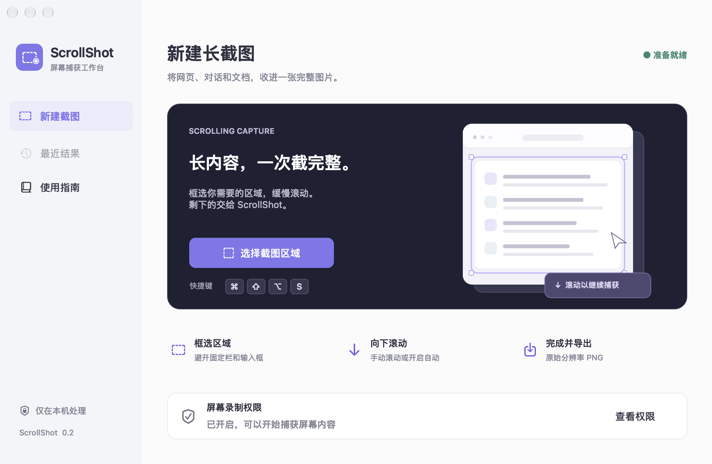
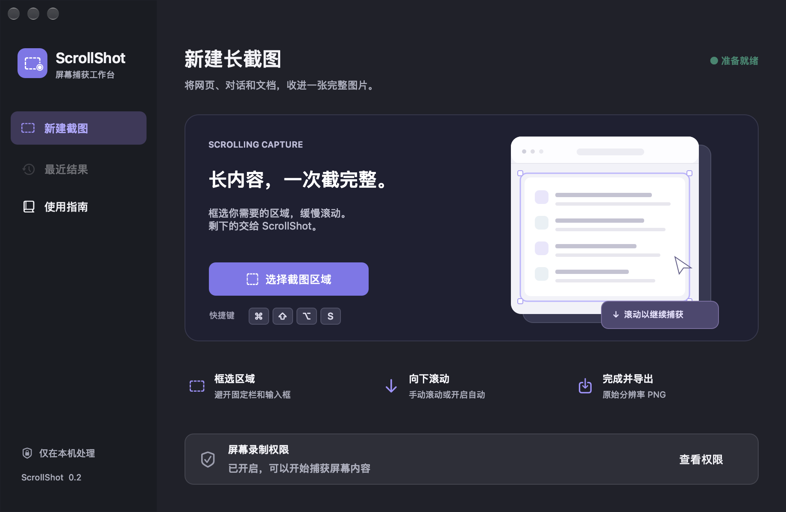
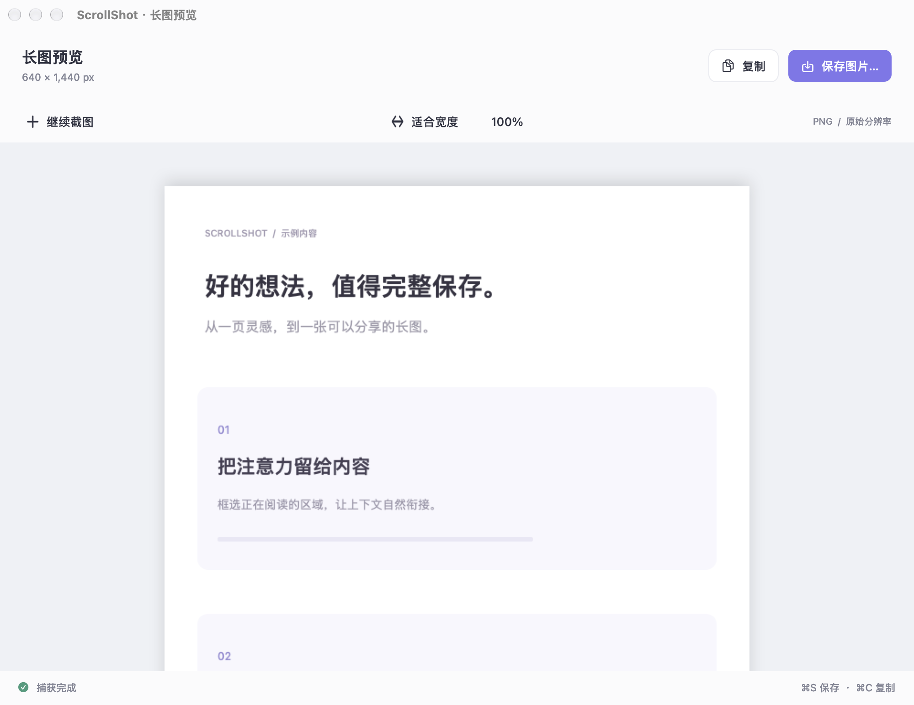
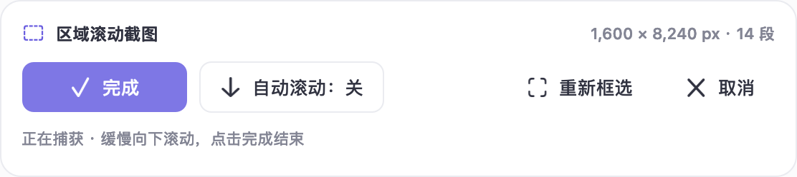

# ScrollShot

原生 macOS 局部滚动长截图工具。框选正文、向下滚动，将网页、对话和文档保存为一张连续长图。

Native regional scrolling screenshots for macOS. Select an area, scroll down, then preview, copy or save a full-resolution PNG.

[下载安装包 / Download](https://github.com/lvvvkvv/ScrollShot/releases/latest) · [English](README.en.md) · [MIT License](LICENSE)



## 功能

- 局部区域框选，进入选区立即显示十字光标，第一次按下即可拖拽。
- 手动向下滚动拼接；可选自动滚动。
- 多显示器选区、取消操作和重新框选。
- 图片预览、适合宽度、100% 缩放、复制与 PNG 导出。
- 浅色 / 深色工作台与紧凑截图工具条。
- 完全本机处理，无账号、无上传、无外部依赖。

## 下载和使用

从 [Releases](https://github.com/lvvvkvv/ScrollShot/releases) 下载 **ScrollShot-0.2.1-macOS-AppleSilicon.zip**，解压并打开 ScrollShot.app。

当前预编译版本适用于 **Apple Silicon（M1 及更新芯片）**，要求 **macOS 14 或更新版本**。

1. 在「系统设置 → 隐私与安全性 → 录屏与系统录音」允许 ScrollShot，随后退出并重开应用。
2. 点击「选择截图区域」，或按 **⌘ ⇧ ⌥ S**，框选会滚动的正文。
3. 点击「开始捕获」，将鼠标放在正文内，缓慢向下滚动。
4. 点击「完成」，预览、复制或保存 PNG。预览中 **⌘S** 保存，**⌘C** 复制。

自动滚动额外需要「辅助功能」权限；手动滚动无需这项权限。**Esc** 取消当前选区或捕获。「最近结果」仅保留最近一张截图，请及时保存。

> 当前为早期试用版本，下载包使用本地临时签名，尚未进行 Developer ID 签名和 Apple 公证。更新后可能需要重新授权录屏。若系统权限开关已开启但应用仍显示未授权，请移除旧权限条目，重新添加当前应用并重启。正式分发将需要稳定的开发者签名身份。

## 界面

| 深色工作台 | 图片预览 |
| --- | --- |
|  |  |



图片为实际原生界面渲染，预览中的文档为示例内容。

## 从源码构建

安装 Apple Command Line Tools（或完整 Xcode），在项目目录运行：

```sh
./test.sh
./build-app.sh "$PWD/dist"
```

生成的应用位于 `dist/ScrollShot.app`。构建脚本默认采用本地临时签名，不需要 Apple 开发者账号。命令行工具版本不同，首次构建耗时可能较长。

额外的光标交互回归检查：

```sh
./test-selection.sh
```

该检查会短暂显示选区覆盖层，需要在已登录桌面的 Mac 会话中运行，不适用于无图形界面的环境。

## 已知限制

- 目前仅支持向下的纵向滚动。请从目标内容顶部开始，保留相邻画面的足够重叠，不要拖动滚动条大幅跳转。
- 避开固定导航栏、聊天输入框和滚动条。动画、视频、大片空白、重复内容、懒加载及虚拟列表可能干扰拼接。
- 出现「画面未衔接」时，可缓慢向上回滚一些，再向下继续，或分段截图。
- 单张上限为 **8000 万像素 / 40,000 像素高**；到达上限时保留已捕获内容。
- 捕获时请勿移动窗口、改变缩放、切换空间或调整显示器连接。
- 尚未完成所有应用、多显示器组合与自动滚动场景的完整兼容性验证。

## 代码结构

- `Sources/LongShot/`：原生工作台、区域选择、捕获流程与预览导出。
- `Sources/LongShotCore/`：图像匹配、长图合成与坐标转换。
- `Tests/LongShotCoreTests/`：匹配偏移、重复画面、异常跳转、像素顺序、内存限制和坐标检查。
- `Tests/SelectionChecks/`：立即十字光标、首次按下、跨屏光标和取消恢复检查。
- `Assets/`：应用图标；`docs/images/`：界面预览。

内部 Swift Package 目标保留 `LongShot` / `LongShotCore` 名称，产品名称为 ScrollShot。

## 开源与贡献

采用 [MIT License](LICENSE)。欢迎提交问题和改进建议。请在问题描述中附上 macOS 版本、芯片型号、目标应用和可复现步骤；避免上传含个人或工作敏感信息的截图。

ScrollShot 使用自行编写的代码和界面资源。CleanShot X 仅作为交互流程参考，不包含其源码或素材。
